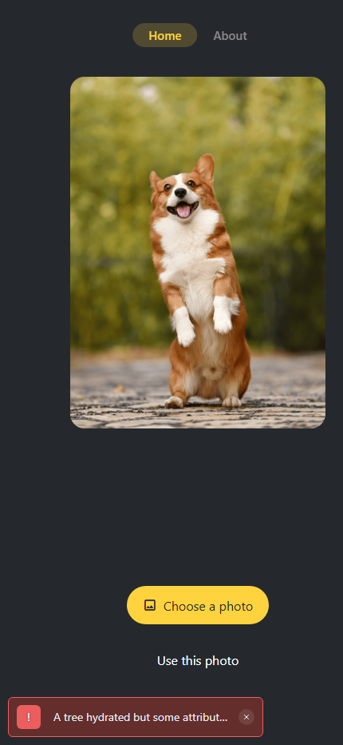
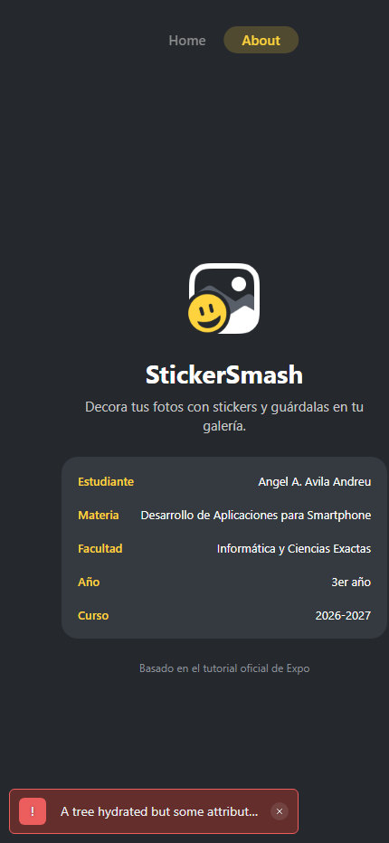

# StickerSmash

Aplicación móvil multiplataforma desarrollada con **Expo**, **Expo Router** y **TypeScript** como parte de la práctica de evaluación de la materia **Desarrollo de Aplicaciones para Smartphone**.

StickerSmash permite elegir una foto de la galería (o usar una imagen de ejemplo), decorarla con stickers, arrastrarlos y escalarlos con gestos, y guardar el resultado en la galería del dispositivo o descargarlo en la web.

**Repositorio:** <https://github.com/ALXP27/StickerSmash>

## Datos del estudiante

| Campo | Valor |
| --- | --- |
| Nombre | Angel A. Avila Andreu |
| Materia | Desarrollo de Aplicaciones para Smartphone |
| Facultad | Informática y Ciencias Exactas |
| Año | 3er año |
| Curso | 2026-2027 |

## Capturas de la aplicación

| Pantalla principal | Pantalla About |
| --- | --- |
|  |  |

> Las capturas se generaron ejecutando la aplicación en el navegador web con `npx expo start --web`.

## Funcionalidades implementadas

1. **Creación del proyecto** con la plantilla oficial de Expo (SDK 58) usando TypeScript y Expo Router.
2. **Navegación por pestañas nativas** (`NativeTabs`) con las pantallas **Home** y **About**, además de una ruta `+not-found` personalizada.
3. **Diseño de pantallas** con Flexbox, `expo-image`, `SafeAreaView` y botones nativos de Expo UI para Android/iOS con variante web.
4. **Selector de imágenes** con `expo-image-picker`, incluyendo recorte en Android/iOS.
5. **Selector de stickers** mediante un `BottomSheet` de Expo UI con una cuadrícula de emojis.
6. **Gestos táctiles** con React Native Gesture Handler y Reanimated: arrastrar el sticker y doble toque para escalarlo, manteniéndolo dentro de la imagen.
7. **Captura y guardado** con `react-native-view-shot` y `expo-media-library` en Android/iOS; descarga directa en la web.
8. **Configuración de producción**: barra de estado clara, color del splash screen e icono de la aplicación en `app.json`.

## Tecnologías utilizadas

- Expo SDK 58 / React Native 0.88 / React 19
- Expo Router (navegación por archivos y pestañas nativas)
- TypeScript en modo estricto
- Expo UI (`@expo/ui`) para componentes nativos
- `expo-image` y `expo-image-picker`
- `react-native-gesture-handler` y `react-native-reanimated`
- `react-native-view-shot` y `expo-media-library`

## Estructura del proyecto

```text
src/
  app/
    _layout.tsx          # Layout raíz, StatusBar y GestureHandlerRootView
    +not-found.tsx       # Ruta 404 personalizada
    (tabs)/
      _layout.tsx        # Pestañas nativas Home / About
      index.tsx          # Pantalla principal (editor de stickers)
      about.tsx          # Información de la app y del estudiante
  components/
    button.tsx           # Botón web (variantes .android.tsx y .ios.tsx)
    circle-button.tsx    # Botón circular para añadir stickers
    icon-button.tsx      # Botones Reset / Save
    emoji-picker.tsx     # Bottom sheet del selector
    emoji-list.tsx       # Cuadrícula de stickers
    emoji-sticker.tsx    # Sticker animado con gestos
    image-viewer.tsx     # Imagen de fondo seleccionada
assets/images/           # Iconos, splash y stickers
docs/                    # Enunciado de la práctica y capturas
```

## Instalación y ejecución

### Requisitos

- Node.js LTS
- npm
- Expo Go en un dispositivo Android o iOS (opcional para web)

### Pasos

```bash
# 1. Clonar el repositorio
git clone https://github.com/ALXP27/StickerSmash.git
cd StickerSmash

# 2. Instalar dependencias
npm install

# 3. Iniciar el servidor de desarrollo
npx expo start
```

Desde la terminal de Expo:

- Pulsa **w** para abrir la versión web.
- Escanea el código QR con **Expo Go** en Android.
- En iOS, escanea el QR con la cámara e inicia sesión con una cuenta gratuita de Expo tanto en Expo Go como en la CLI (`npx expo login`).
- Si el dispositivo no detecta el servidor por la red local, usa `npx expo start --tunnel`.

### Comandos útiles

```bash
npm run web              # Ejecutar en el navegador
npm run typecheck        # Verificar tipos sin generar archivos
npx expo export --platform web   # Generar el bundle web de producción
```

## Retos encontrados durante el desarrollo

- **Cambios de API en SDK 58:** el tutorial actual usa `NativeTabs`, componentes de Expo UI y los hooks `useTapGesture` / `usePanGesture` de Gesture Handler v3, diferentes de versiones anteriores del tutorial. Fue necesario adaptar el código y verificar las exportaciones reales de cada paquete.
- **Componentes por plataforma:** los botones nativos requieren archivos `.android.tsx`, `.ios.tsx` y `.tsx` (web) con las mismas props. Mantener la paridad de tipos entre los tres archivos fue uno de los puntos más delicados.
- **Bottom sheet multiplataforma:** el `BottomSheet` de Expo UI es un componente nativo; el contenido de React Native debe envolverse en `RNHostView`. En web el comportamiento y los puntos de anclaje cambian respecto a Android/iOS.
- **Gestos en web:** el navegador inicia su propio arrastre al presionar una imagen, lo que cancelaba el gesto de tipo pan. Se resolvió aplicando `pointerEvents: 'none'` a la imagen para que el `Animated.View` reciba los eventos.
- **Captura de la composición:** fue necesario usar `collapsable={false}` en la vista capturada y distinguir el flujo nativo (`expo-media-library`) del flujo web (descarga mediante un `data-uri`).
- **Permisos:** `expo-media-library` solicita permiso de escritura al iniciar. En web no existe galería, por lo que se implementó la descarga directa del JPEG.
- **Entorno de desarrollo:** la instalación de Git y de algunas dependencias requirió reintentos por problemas de red; se documenta la instalación portable de Git como alternativa sin permisos de administrador.
- **Expo Go y SDK:** Expo Go solo ejecuta la versión más reciente del SDK, por lo que el proyecto se mantuvo en SDK 58 y la app del dispositivo debe estar actualizada.

## Configuración de producción

En `app.json` se configuró:

- `icon` y los iconos adaptativos de Android con los assets de StickerSmash.
- Splash screen con fondo `#25292e` e imagen centrada.
- Barra de estado con estilo `light` desde `expo-status-bar`.
- Rutas tipadas y React Compiler habilitados.

> El splash screen y el icono no se visualizan en Expo Go; requieren un build de desarrollo o de producción.

## Créditos

- Tutorial oficial: [Expo Tutorial – StickerSmash](https://docs.expo.dev/tutorial/introduction/)
- Assets e imágenes: [Expo](https://docs.expo.dev/static/images/tutorial/sticker-smash-assets.zip)
